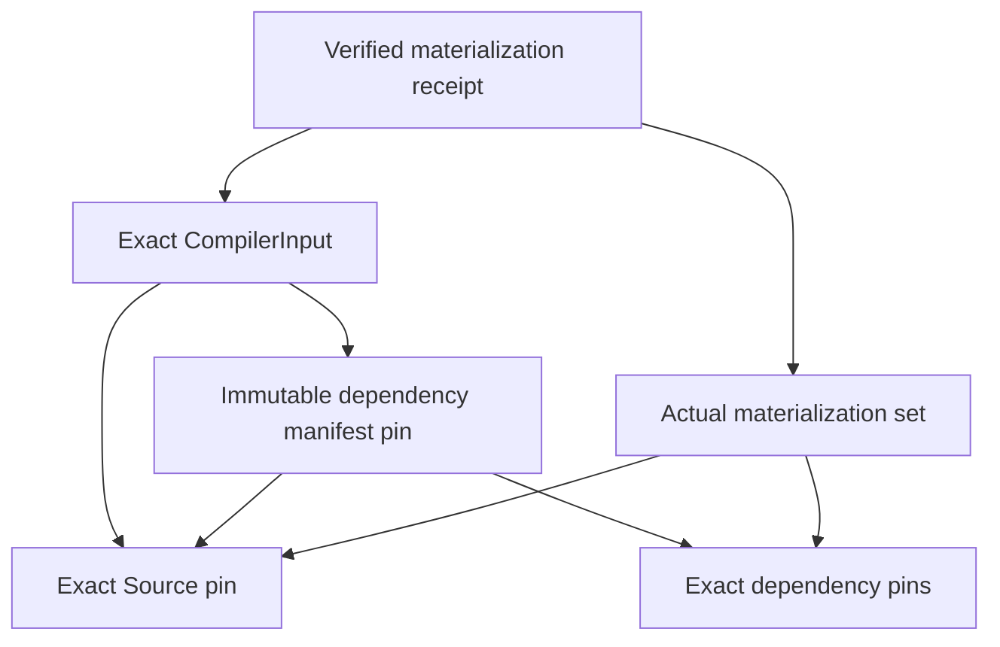

# ProjectIDE immutable dependency manifest decision proposal

Related: #905, #798, #888, #1034, #1029. Status: **Option B selected by the
2026-11-03 task instruction; concrete schema and authority semantics NOT APPROVED**.
The task selects the architecture direction. It does not approve an unspecified
wire format, eligibility policy, authenticated receipt producer or activation.
No newer concrete schema approval was found in the inspected #905/#798/#888 records.

Normative requirements remain the applied A-R2 contracts: MODEL-03/10,
COMP-01/02/03/04/07/11, ANALYSIS-04/07, SEM-01, PTEST-09, PROV and Q09-B.
The effective-contracts path is
`Coglatas-Spec/docs/specs/coglatas-core-v4/17-governance/decisions/2026-10-03-a/effective-contracts.md`.
The parallel-client restart is Spec #300, merge
`16066f182beef0cd7ce57aa23849922f634d82c7`, decision path
`17-governance/decisions/2026-10-31-projectide-web-windows`.
These are requirement references, not approval of this proposal's schema.
Private specification text is not reproduced here.

## Problem and alternatives

Whole-Source canonical hashing currently includes preserved opaque content.
Embedding that same whole-Source digest in a local typed reference asks for a
cryptographic fixed point. Rehashing repeatedly, ignoring a mismatch or discarding
opaque fields cannot repair that contract.

| Concern | A: versioned internal manifest | B: separately pinned immutable manifest |
| --- | --- | --- |
| Hash boundary | Explicit versioned exclusion of self-reference digest fields; every exclusion needs specification and tamper analysis | Source content never embeds its own digest or dependency-manifest digest; manifest/input/receipt have separate domains |
| Identity | New internal document/dependency identity must reconcile with whole-Source identity | Source identity, dependency declaration identity and actual receipt identity remain distinct |
| Canonicalization | Special projection and source-map rules, plus canonical serialization | Existing canonical primitive can be reused; each artifact defines its complete semantic payload |
| Offline | Internal manifest travels with Source; exclusions still need version support | Bundle exact Source, manifest and required bodies; missing bundles remain incomplete |
| Migration | Source schema/digest interpretation changes | New Source/reference and CompilerInput versions or explicit mapping still required; v1 cannot be silently reinterpreted |
| Security | An excluded field can become an unbound substitution channel | Exact Source + manifest binding prevents substitution; a manifest alone proves no acquisition or authority |
| Cost | One container, more complex integrity rules | More artifacts and atomic input assembly; simpler non-circular integrity boundaries |

Recommend and proceed with **B**. Keep Source content stable while pinning the
dependency declaration separately. This separates intended dependencies from
observed acquisition and permits offline input assembly without a network lookup.
A remains a possible explicitly versioned alternative, not the selected workstream.

## Proposed dependency and hash boundaries

Arrows below mean "includes an exact identity/pin in its hashed semantic payload".
Names are architectural roles, not approved serialized property names.

Source has no edge back to Manifest, CompilerInput or Receipt. Dependency bodies
have no back edge to the Receipt. No receipt digest participates in Source,
Manifest or CompilerInput content identity. Construction order is Source/dependency
bodies, Manifest, CompilerInput, then actual receipt. Logical reference cycles
are evaluated separately from this artifact-content DAG.

Proposed canonical rules, each subject to concrete schema review:

- Reuse owned canonical encoding v1; UTF-8, no BOM/trailing newline, stable token/ID
  spelling, exact numbers and unknown preservation. Sort only declared unordered
  sets by typed identity; reject duplicate/conflicting entries rather than first wins.
- Source retains its current whole-content hash domain. Dependency Manifest and
  Receipt require distinct owned, versioned domain tags; their exact allocation
  and schema names remain pending. Never alias an existing Source digest to a
  Manifest digest merely because both use SHA-256.
- Hash the artifact's full semantic payload, excluding only its own derived
  identity/digest and declared nonsemantic telemetry. Exclusions require explicit
  schema ownership. Include schema/canonical version, complete scope/context,
  exact Source pin and all applicable dependency kind/version/digest/coverage pins.
- Bind Tenant/Project/Branch and committed revision, candidate stamps or Scenario
  base/overlay exactly. Same content/tree at another revision/commit is not an
  interchangeable context. Git export metadata does not replace semantic identity.
- Atomically assemble one immutable CompilerInput with both pins. The pure Core
  reads no independently changing "latest" manifest. Persist complete pins for
  reproduction and detect identity/digest conflicts.
- A receipt records the exact input and actual verified bodies, integrity results,
  partial/missing/unsupported outcomes and acquisition provenance. A declared
  dependency, matching digest, caller boolean or synthetic result is not a verified
  receipt. Producer authentication/attestation and current access remain separate.
- Replay may reproduce an old immutable input but cannot assert freshness for a
  new desired context or restore revoked authority. Acquisition, viewing and
  applying independently reauthorize; historical records remain immutable.

New local references must identify a dependency/target without embedding the
containing Source's own digest. The precise versioned mapping from a reference
to its separately pinned manifest entry remains a schema decision. Existing v1
entity/document external references continue using materialized **Source** digests.
Resource/external-snapshot references keep Unsupported until their typed body and
actual receipt contracts exist. No v1 field is repurposed in this proposal.

## Verification and migration decisions

| Case | Required evidence / failure behavior |
| --- | --- |
| Canonicalization/domain/version | Golden vectors across hosts, reordered unordered entries, exact numbers/Unicode/opaque preservation, distinct artifact domains, unknown-version rejection |
| Exact Source/dependency pins | Substituted body, version, manifest, input or context rejected; same-tree/different-revision and candidate/Scenario changes invalidate reuse |
| Replay/stale | Old receipt remains historical; new desired input is Stale; no mutation to a new PASS |
| Duplicate/conflicting entries | Deterministic invalid/ambiguous diagnostic, independent of order |
| Partial/missing dependencies | Coverage remains partial; actual body absence cannot become zero demand or executable closure |
| Unauthorized materialization | Deny access, preserve safe coverage limitation, no hidden names/IDs/counts in public diagnostics |
| Tampered/fabricated receipt | Verify exact payload digest, input/materialization association and producer trust separately; caller assertions cannot attest execution |
| Cancellation/exhaustion | Bound enumeration/hash/graph work, explicit incomplete execution; never sign a complete receipt for partial work |
| Offline | Exact bundled bodies and manifest required; integrity checks remain identical; no implicit network fetch or offline authority grant |
| Wire compatibility | Existing Source/input/result golden bytes remain unchanged; new schema migration creates a new version/input with explicit origin mapping |
| Content DAG | Independent prototype tests verify acyclicity, substitution propagation and no Source-to-receipt/manifest hash dependency; not wire-schema acceptance |

Owner/schema review must fix: artifact schemas/domains/identity derivations;
reference-to-entry mapping; dependency kind descriptors; migration/old-reader
behavior; authenticated receipt/authorization freshness interface; offline bundle
format and atomic assembly; receipt protection/redaction/retention; provenance
and eligibility policy. No production defaults, RLS/SEC-ARCH or release activation
follow from selecting B. Record decisions in #905 and the existing continuation
ledger, not a replacement management register.

## Independent work and External IR closure

The Evidence/Resource Pure Core slice reuses existing contracts for bounded
consistency checks without introducing a public receipt or manifest schema.
Evidence claims retain original result/input/target/provenance; all assessments
remain incomplete until actual materialization and eligibility exist.

Reference resolution finds a target. Lowering requires supported semantics for
every transitive dependency and exact version closure. The safe next graph slice
must accept only authorized Source-backed nodes, key by full scoped context and
digest, reject conflicting versions/duplicate identities, preserve unsupported
nodes and partial frontiers, and apply declared kind-specific cycle policies.
It must count every node/edge against shared budgets and cancellation, use stable
typed ordering and deterministic topological processing where acyclicity applies.
Cycles cannot be broken by arbitrarily dropping edges. A same-key/different-body
node is invalid; cross-Project nodes need explicit pins and authority. Unfetched
transitive edges remain unknown, never an empty complete adjacency list.

Current materializations do not contain a per-dependency CompilerInput/manifest
closure. Therefore graph discovery/lowering cannot safely certify transitive
completion. `external-closure-not-lowered` stays intact; no executable IR or Complete
Pass is added. Pure graph preparation is limited to independent content-DAG
prototype tests until those semantic inputs are approved and available.

#1128 remains SUSPENDED / NOT_EVALUATED. #1144 native UI/IME/activation remains HOLD.
