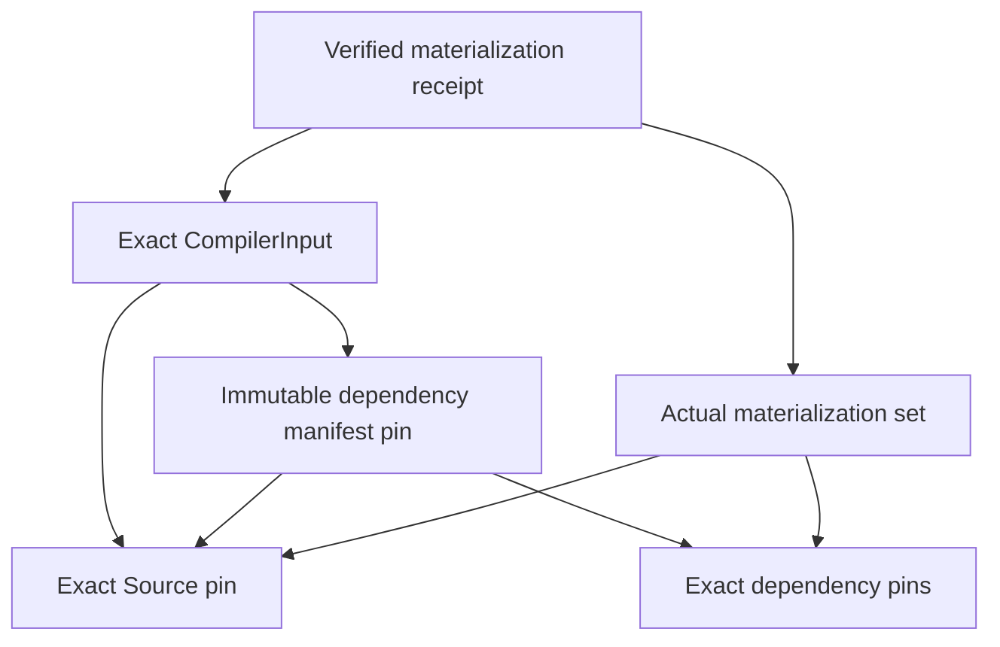

# ProjectIDE immutable dependency manifest decision proposal

Related: #905, #798, #888, #1034, #1029. Status: **Option B selected by the
2026-11-03 task instruction; concrete schema and authority semantics NOT APPROVED**.
The task selects the architecture direction. It does not approve an unspecified
wire format, eligibility policy, authenticated receipt producer or activation.
No newer concrete schema approval was found in the inspected #905/#798/#888 records.

Normative requirements remain the applied A-R2 contracts: MODEL-03/10,
COMP-01/02/03/04/07/11, ANALYSIS-04/07, SEM-01, PTEST-09, PROV and Q09-B.
The effective-contracts path is
`Coglatas-Spec/docs/specs/coglatas-core-v4/17-governance/decisions/2026-10-03-a/effective-contracts.md`.
The parallel-client restart is Spec #300, merge
`16066f182beef0cd7ce57aa23849922f634d82c7`, decision path
`17-governance/decisions/2026-10-31-projectide-web-windows`.
These are requirement references, not approval of this proposal's schema.
Private specification text is not reproduced here.

## Problem and alternatives

Whole-Source canonical hashing currently includes preserved opaque content.
Embedding that same whole-Source digest in a local typed reference asks for a
cryptographic fixed point. Rehashing repeatedly, ignoring a mismatch or discarding
opaque fields cannot repair that contract.

| Concern | A: versioned internal manifest | B: separately pinned immutable manifest |
| --- | --- | --- |
| Hash boundary | Explicit versioned exclusion of self-reference digest fields; every exclusion needs specification and tamper analysis | Source content never embeds its own digest or dependency-manifest digest; manifest/input/receipt have separate domains |
| Identity | New internal document/dependency identity must reconcile with whole-Source identity | Source identity, dependency declaration identity and actual receipt identity remain distinct |
| Canonicalization | Special projection and source-map rules, plus canonical serialization | Existing canonical primitive can be reused; each artifact defines its complete semantic payload |
| Offline | Internal manifest travels with Source; exclusions still need version support | Bundle exact Source, manifest and required bodies; missing bundles remain incomplete |
| Migration | Source schema/digest interpretation changes | New Source/reference and CompilerInput versions or explicit mapping still required; v1 cannot be silently reinterpreted |
| Security | An excluded field can become an unbound substitution channel | Exact Source + manifest binding prevents substitution; a manifest alone proves no acquisition or authority |
| Cost | One container, more complex integrity rules | More artifacts and atomic input assembly; simpler non-circular integrity boundaries |

Recommend and proceed with **B**. Keep Source content stable while pinning the
dependency declaration separately. This separates intended dependencies from
observed acquisition and permits offline input assembly without a network lookup.
A remains a possible explicitly versioned alternative, not the selected workstream.

## Proposed dependency and hash boundaries

Arrows below mean "includes an exact identity/pin in its hashed semantic payload".
Names are architectural roles, not approved serialized property names.



Source has no edge back to Manifest, CompilerInput or Receipt. Dependency bodies
have no back edge to the Receipt. No receipt digest participates in Source,
Manifest or CompilerInput content identity. Construction order is Source/dependency
bodies, Manifest, CompilerInput, then actual receipt. Logical reference cycles
are evaluated separately from this artifact-content DAG.

Proposed canonical rules, each subject to concrete schema review:

- Reuse owned canonical encoding v1; UTF-8, no BOM/trailing newline, stable token/ID
  spelling, exact numbers and unknown preservation. Sort only declared unordered
  sets by typed identity; reject duplicate/conflicting entries rather than first wins.
- Source retains its current whole-content hash domain. Dependency Manifest and
  Receipt require distinct owned, versioned domain tags; their exact allocation
  and schema names remain pending. Never alias an existing Source digest to a
  Manifest digest merely because both use SHA-256.
- Hash the artifact's full semantic payload, excluding only its own derived
  identity/digest and declared nonsemantic telemetry. Exclusions require explicit
  schema ownership. Include schema/canonical version, complete scope/context,
  exact Source pin and all applicable dependency kind/version/digest/coverage pins.
- Bind Tenant/Project/Branch and committed revision, candidate stamps or Scenario
  base/overlay exactly. Same content/tree at another revision/commit is not an
  interchangeable context. Git export metadata does not replace semantic identity.
- Atomically assemble one immutable CompilerInput with both pins. The pure Core
  reads no independently changing "latest" manifest. Persist complete pins for
  reproduction and detect identity/digest conflicts.
- A receipt records the exact input and actual verified bodies, integrity results,
  partial/missing/unsupported outcomes and acquisition provenance. A declared
  dependency, matching digest, caller boolean or synthetic result is not a verified
  receipt. Producer authentication/attestation and current access remain separate.
- Replay may reproduce an old immutable input but cannot assert freshness for a
  new desired context or restore revoked authority. Acquisition, viewing and
  applying independently reauthorize; historical records remain immutable.

New local references must identify a dependency/target without embedding the
containing Source's own digest. The precise versioned mapping from a reference
to its separately pinned manifest entry remains a schema decision. Existing v1
entity/document external references continue using materialized **Source** digests.
Resource/external-snapshot references keep Unsupported until their typed body and
actual receipt contracts exist. No v1 field is repurposed in this proposal.

## Verification and migration decisions

| Case | Required evidence / failure behavior |
| --- | --- |
| Canonicalization/domain/version | Golden vectors across hosts, reordered unordered entries, exact numbers/Unicode/opaque preservation, distinct artifact domains, unknown-version rejection |
| Exact Source/dependency pins | Substituted body, version, manifest, input or context rejected; same-tree/different-revision and candidate/Scenario changes invalidate reuse |
| Replay/stale | Old receipt remains historical; new desired input is Stale; no mutation to a new PASS |
| Duplicate/conflicting entries | Deterministic invalid/ambiguous diagnostic, independent of order |
| Partial/missing dependencies | Coverage remains partial; actual body absence cannot become zero demand or executable closure |
| Unauthorized materialization | Deny access, preserve safe coverage limitation, no hidden names/IDs/counts in public diagnostics |
| Tampered/fabricated receipt | Verify exact payload digest, input/materialization association and producer trust separately; caller assertions cannot attest execution |
| Cancellation/exhaustion | Bound enumeration/hash/graph work, explicit incomplete execution; never sign a complete receipt for partial work |
| Offline | Exact bundled bodies and manifest required; integrity checks remain identical; no implicit network fetch or offline authority grant |
| Wire compatibility | Existing Source/input/result golden bytes remain unchanged; new schema migration creates a new version/input with explicit origin mapping |
| Content DAG | Independent prototype tests verify acyclicity, substitution propagation and no Source-to-receipt/manifest hash dependency; not wire-schema acceptance |

Owner/schema review must fix: artifact schemas/domains/identity derivations;
reference-to-entry mapping; dependency kind descriptors; migration/old-reader
behavior; authenticated receipt/authorization freshness interface; offline bundle
format and atomic assembly; receipt protection/redaction/retention; provenance
and eligibility policy. No production defaults, RLS/SEC-ARCH or release activation
follow from selecting B. Record decisions in #905 and the existing continuation
ledger, not a replacement management register.

## Independent work and External IR closure

The Evidence/Resource Pure Core slice reuses existing contracts for bounded
consistency checks without introducing a public receipt or manifest schema.
Evidence claims retain original result/input/target/provenance; all assessments
remain incomplete until actual materialization and eligibility exist.

Reference resolution finds a target. Lowering requires supported semantics for
every transitive dependency and exact version closure. The safe next graph slice
must accept only authorized Source-backed nodes, key by full scoped context and
digest, reject conflicting versions/duplicate identities, preserve unsupported
nodes and partial frontiers, and apply declared kind-specific cycle policies.
It must count every node/edge against shared budgets and cancellation, use stable
typed ordering and deterministic topological processing where acyclicity applies.
Cycles cannot be broken by arbitrarily dropping edges. A same-key/different-body
node is invalid; cross-Project nodes need explicit pins and authority. Unfetched
transitive edges remain unknown, never an empty complete adjacency list.

Current materializations do not contain a per-dependency CompilerInput/manifest
closure. Therefore graph discovery/lowering cannot safely certify transitive
completion. `external-closure-not-lowered` stays intact; no executable IR or Complete
Pass is added. Pure graph preparation is limited to independent content-DAG
prototype tests until those semantic inputs are approved and available.

#1128 remains SUSPENDED / NOT_EVALUATED. #1144 native UI/IME/activation remains HOLD.

## Concrete schema decision packet — 2026-11-03 continuation

**Architecture: selected. All concrete rows below: PROPOSED / OWNER DECISION
REQUIRED. No formal Wire V1 is allocated, implemented or approved by this packet.**
No APPROVED review, CODEOWNER acceptance or concrete schema decision was found
on the reacquired #1666/#905/#798 records. CODEOWNERS identifies `@NYGsatoshi`;
the task's authorization to implement bounded Core is not a schema sign-off.

Normative cross-check: Coglatas-Spec main
`850a5d9376db11e75235cf55e03ebed4de9c0510`, effective-contracts blob
`1f333c99d12fe84384fd350514ec9399b0c80673`, and the controlling A-R2 amendment;
parallel-client decision `2026-10-31-projectide-web-windows/decision.json` at the
same commit. References below name requirements without publishing private text.
COMP-01/02/04/08/11/15, MODEL-03/10/17/18/20, ID-01/02/03/07/08/09,
ANALYSIS-04/07, PTEST-09, PROV, JOB-04/07/10/12 and Q09-B govern the proposal.
They do not allocate these concrete schemas/domains/interfaces. #905 and #798
remain open with the previously published bounded candidate evidence.

Each row records a concrete recommendation, its unresolved decision and impact,
and an independent test obligation. Artifact names/domain tags below are proposed
spellings only; no registry allocation or current-v1 reinterpretation follows.

| Decision | Recommendation / proposed shape | Normative source | Unresolved / compatibility impact | Independent verification |
| --- | --- | --- | --- | --- |
| Artifact type / schema version | Separate `dependency-manifest`, `compiler-input-association`, `materialization-set`, `materialization-receipt` roles; each carries artifact type, schema version and canonical version | COMP-01/02, ID-07, MODEL-20 | Exact registered type names and version allocation; current `coglatas.compiler-input/1` stays unchanged | Reject wrong artifact type, old/unknown schema and mixed-role envelopes |
| Canonical encoding | Reuse owned canonical JSON semantics for proposed v1 encoding: UTF-8 without BOM/newline, exact numeric forms, stable Unicode/member order; sort only explicitly unordered collections | COMP-08, MODEL-10/17 | Whether every role uses existing encoding v1 and which collections are sets; no Source golden changes | Cross-host golden vectors including Unicode, exact numbers, preserved unknown fields and permutation |
| Hash domain | Domain includes owned artifact type and schema version, separated unambiguously from complete canonical payload; e.g. tentative `coglatas.dependency-manifest/1` | ID-07/08/09, JOB-04 | Domain allocation and framing bytes require approval; no digest alias across types | Same bytes in different roles/versions have different digests; malformed framing rejects |
| Typed artifact identity | Artifact pin includes role, schema/canonical version, digest algorithm/value and complete semantic scope/context; derived ID is type-tagged and bound to full digest | ID-01/07, JOB-04 | Exact ID derivation/truncation/collision behavior; do not borrow EntityId or CompilerInputId semantics | Wrong type/domain/version, collision projection and truncated-ID substitution reject |
| Source pin | Complete Source digest plus exact Tenant/Project/Branch/revision or candidate/Scenario identity and Source schema/canonical version | COMP-01, ID-01/02/03 | Whole Source remains immutable; same tree/content at another semantic revision is distinct | Source substitution and same-content/different-context rejection |
| Dependency manifest pin | Digest of separate full declaration artifact with exact Source pin and typed dependency entries | COMP-01/04, MODEL-17 | Entry type vocabulary and identity ownership; existing embedded Source document manifest is a different role | Manifest substitution, missing/unknown kind, duplicate/conflicting pins |
| Reference-to-entry mapping | New versioned local references use an opaque typed entry key plus target identity; their containing Source never embeds its own whole digest or the enclosing manifest digest | MODEL-10/20, ID-05, COMP-04 | Exact reference grammar, scope of entry keys and target-kind mapping are blocking decisions | Missing/ambiguous key, wrong kind/context and self-hash-cycle rejection |
| Exact CompilerInput association | Association includes full Source pin and manifest pin plus existing compiler/ruleset/profile/semantic inputs; assemble atomically, no `latest` lookup | COMP-01/08/11/15 | New input version/adapter and old-reader rejection; not an extension silently added to existing V1 | Source/manifest/settings substitution changes identity; stale desired input rejects reuse |
| Materialization identity | Actual set contains exact admitted body pins and explicit complete/partial/missing/unsupported outcomes; its own content identity is separate from declared Manifest | COMP-02/11, MODEL-17, ANALYSIS-07 | Body-kind representation, entry/status grammar and inclusion of absence observations | Declared versus actual mismatch, absent/partial body, duplicate/conflicting body |
| Receipt/Input matching | Receipt claims exact full input association and actual-set identity; optional prior-receipt link is historical, never a freshness grant | COMP-11, JOB-04 | Receipt schema and capture policy; input/Source/Manifest hashes exclude every receipt digest | Old receipt/new desired input, substitution and independent content-DAG controls |
| Producer responsibility | Producer supplies immutable bytes and acquisition provenance; protected authentication binds the complete receipt payload to a specific approved producer | PROV, JOB-10/12 | Trust root, signer/runner identity, key rotation, revocation and attestation are NOT APPROVED | Fabricated signer/boolean, tampered payload, revoked/unrecognized producer reject |
| Verifier responsibility | Recompute hashes, check type/version/scope, exact input/actual sets and independent stage results; caller claim remains UNVERIFIED without authentication | COMP-11, ANALYSIS-04, JOB-04/12 | Verifier interface and supported proof formats; digest match alone proves no producer | Correct hash with untrusted producer remains UNVERIFIED / ineligible |
| Authorization freshness | Host reauthorizes acquisition/view/export/apply separately against desired current context; verifier accepts a scoped explicit freshness response, never cached authority inferred from digest | COMP-11, JOB-07, Q09-B | Interface, atomicity/races, expiry/permit/revocation policy; no production resolver/cache is added | Denied current authority, replay after revocation and opaque unavailable responses |
| Scope / Branch / revision | Every pin binds typed Tenant and owning resource scope; Project-local context includes full Branch/revision | ID-01/02, Q09-B | Tenant Resource identity versus Project binding must remain explicit | Cross-Tenant/Project/Branch and wrong-revision rejection without private diagnostic payload |
| Candidate / Scenario | Bind immutable proposal version and Scenario base+overlay/assumptions, not display names or Git commit alone | ID-03, COMP-01/08 | Mapping to current contexts and Scenario input version | Different candidate/Scenario/base/overlay cannot replay an old claim |
| Unknown fields | Preserve opaque bytes/meaning; include semantic unknowns in identity; supported reader returns Unsupported when unknown meaning affects verification/execution | MODEL-17/18 | Explicit nonsemantic field allocation and handling of unknown criticality; no ignored unknowns to gain PASS | Round-trip unknown data, tamper propagation and unsupported execution |
| Migration / old readers | Introduce explicit new role/version; preserve original artifacts and origin mapping; old readers reject unsupported version and retain recoverable data | MODEL-20, ID-07, COMP-15 | Migration path, supported engine range and rollback behavior require approval | Old reader/unknown canonical version, migration reproducibility, Source golden parity |
| Offline bundle | Bundle a root exact input pin, Source/Manifest bytes and an indexed set of exact bodies/receipts; resolve only indexed bytes with the same verifier, never fetch implicitly | COMP-01/08, DATA-17/20, JOB-10 | Container/index format, atomic import and offline permit rules; no ZIP/JSON format adopted | Missing/truncated/duplicate/substituted entries, offline denial and partial frontier |
| Evidence eligibility | Keep declared/available/integrity/authenticated/current-authorized/eligible/satisfied as seven distinct stages; policy selects target-specific supported proof | MODEL-03, ANALYSIS-04/07, PTEST-09 | Policy owner, requirement/run relation and eligibility contract; synthetic receipt cannot discharge a Requirement | Exact synthetic Complete Pass still lacks eligible evidence; wrong target/kind/premise |
| Redaction / retention | Immutable protected original; authorized redacted view is a separately identified projection linked to original, never rewritten original bytes | PROV, HIST-04/05, COMP-11 | Field classification, authorized export, retention/deletion/Pin periods and capacity remain pending | No hidden names/IDs/counts/digests in findings; redacted view cannot impersonate original proof |
| Failure states | Distinguish Invalid, Missing/Partial, Unknown, Unsupported, Cancelled, Exhausted, Stale, UnverifiedTrust and Unauthorized/opaque unavailable; no default success | MODEL-17, ANALYSIS-07, COMP-11 | Exact wire tokens and aggregation table; retain current result axes until approved | Deterministic diagnosis/order, cancellation during enumeration and shared budgets; never executable partial IR |

### Proposed data shape for owner review

The following is type notation, **not JSON Schema, a supported envelope or an
allocated V1**. All role names/field names below are proposed. `ExactContext`
means the complete existing committed/candidate/Scenario context, with explicit
ownership for Tenant Resources instead of forcing them into a Project Entity.

```text
ArtifactPin = {
  artifactType, schemaVersion, canonicalEncodingVersion,
  scope: { kind, tenantId, projectId? }, context: ExactContext?,
  digest: { algorithm, value }
}
DependencyManifestPayload = {
  artifactType, schemaVersion, canonicalEncodingVersion,
  source: ArtifactPin,
  entries: [{ entryKey, dependencyKind, body: ArtifactPin, coverageClaim }]
}
CompilerInputAssociationPayload = {
  artifactType, schemaVersion, canonicalEncodingVersion,
  source: ArtifactPin, dependencyManifest: ArtifactPin,
  compilerConfiguration: ExactExistingSemanticInput
}
ActualMaterializationSetPayload = {
  artifactType, schemaVersion, canonicalEncodingVersion,
  entries: [{ entryKey, expected: ArtifactPin,
              state: Present | Missing | Partial | Unsupported,
              actual: ArtifactPin? }]
}
MaterializationReceiptPayload = {
  artifactType, schemaVersion, canonicalEncodingVersion,
  compilerInput: ArtifactPin, actualSet: ArtifactPin,
  producerClaim, captureContext, provenance, execution, coverage
}
AuthenticationEnvelope = { receipt: ArtifactPin, protectedProducerProof }
```

Recommended hash framing is the existing `ContentDigest.Compute` primitive:
`SHA-256(UTF8(allocatedDomainTag) || 0x00 || canonicalPayloadBytes)`. The domain
must exclude NUL and be owned/versioned. The full role/schema/canonical/scope
information lives in the payload as well. Recommended identity is an injective
typed tuple `(artifactType, schemaVersion, canonicalEncodingVersion, fullDigest)`
with full scope checked independently; avoid truncation or reuse as a UUID entity
identity. Its wire spelling and any collision/index strategy remain pending.

Derived self identity/digest and the authentication envelope are outside the
receipt's hashed payload. `producerClaim` and any semantic capture context stay
inside that payload; a verifier checks the protected proof against the complete
receipt pin. This avoids a receipt/signature self-cycle. The signature itself,
key/proof formats, trust root and verification/rotation/revocation behavior are
unapproved. A redacted receipt projection must have a different identity, with
explicit authorized linkage; it cannot inherit the original proof automatically.

An `entryKey` maps only within one exact Manifest and its bound Source. A new
reference grammar must establish which Source locators consume which entry and
target. No current `manifest.digest` reference field is repurposed. `actual`
presence does not imply integrity, producer authenticity, current authorization
or eligibility; those stages retain independent verifier/host outcomes.
Missing/Partial/Unsupported entries and absent graph frontiers prevent a closure
claim. Actual-set adjacency and per-kind cycle semantics need their own approved
contract before lowering. Optional fields and unknown-field criticality in this
notation are questions for schema review, not reader defaults.

### Owner decision and implementation boundaries

Approval should name the exact packet revision, selected row values, registry
allocations and migration/reader compatibility before formal Schema V1 work.
Receipt Trust and Evidence Eligibility require separate explicit decisions even
if the data-only schema is accepted. A CODEOWNER source review alone is not a
producer-trust or production-activation grant. No answer is inferred here.

Runtime work proceeds independently through existing types on the new Product
branch based on #1667, not on this Documentation branch. The bounded admission
slice is documented in `projectide-materialization-binding.md` on that branch.
The independent Test line based on #1668 owns the non-normative executable model
and negative controls. Its tuple identities and ASCII hash vectors are examples,
not the schema proposed for adoption or a production verifier. Graph cycle rules
in that model are provisional, kind-specific examples; they do not authorize
external IR lowering. Owner-dependent local reference mapping, actual receipt
production/current authority, Resource/external acquisition, eligible evidence,
transitive closure and native UI/activation remain HOLD.
